# claude-code-mods

兩個 Claude Code 擴展（function hooks 模組），終端和 Claude 桌面版（Code 分頁）都能用：

- **cc-pulse**：輸入框上方的動畫狀態列，顯示用量、額度、花費，以及提示緩存還剩多久過期
- **task-flow**：側邊面板，把 Claude 的計畫畫成縱向時間軸，可以引用任何一步來提出修改

> Claude Code 的擴展 API 目前是搶先體驗版，版本更新時可能改變。這兩個擴展在 Claude Code 2.1.289 上開發與測試。

## cc-pulse：用量與緩存狀態列

<picture>
  <source media="(prefers-color-scheme: dark)" srcset="docs/cc-pulse-dark.svg">
  
</picture>

<sub>圖片是會動的 SVG，用擴展本身的繪製程式和範例資料產生：緩存倒數逐秒跳動，進度條上有光澤掃過。</sub>

輸入框上方的一行：

| 項目 | 內容 |
| --- | --- |
| ctx | 上下文已用的百分比 |
| 5h / 7d | 訂閱方案的 5 小時與 7 天額度；用量超過 80% 時一併顯示重置時間 |
| cache | 提示緩存剩下的時間。Claude 工作時顯示 `live`，過期後顯示 `cold` |
| $ | 這個會話目前的花費 |

- 滑鼠移到任一項上，下方會展開明細，例如「5-hour window · 4% used · resets at 18:33」。
- 數字變化有過渡動畫。桌面版用 SVG 繪製：進度條平滑變化，緩存倒數像里程表一樣逐秒滾動，最後一分鐘會閃爍。

**保溫開關**：cache 旁邊的「保溫」開關，預設關閉。打開後，閒置時會在緩存過期前約 30 秒送出一個極短的請求，讓緩存重新計時，每段閒置最多 3 次；你送出下一則訊息後次數歸零。每次保溫都會以緩存讀取的價格把整段上下文計費一次，上下文越大越貴。

指令：`/pulse` 顯示或隱藏狀態列。

設定放在 `~/.claude/settings.json` 的 `pluginConfigs`：

| 欄位 | 預設值 | 說明 |
| --- | --- | --- |
| `cacheTtl` | `auto` | 緩存有效期：`auto`（自動推測）、`5m`、`1h` |
| `warnBeforeExpiry` | `true` | 緩存過期前一分鐘跳出提示 |
| `keepWarm` | `false` | 新會話是否一開始就打開保溫 |
| `keepWarmMax` | `3` | 每段閒置最多保溫幾次 |

```json
{
  "pluginConfigs": {
    "cc-pulse": { "options": { "cacheTtl": "1h" } }
  }
}
```

## task-flow：任務流程面板

<picture>
  <source media="(prefers-color-scheme: dark)" srcset="docs/task-flow-dark.svg">
  
</picture>

Claude 接到多步驟的需求時，會先在側邊面板畫出計畫，做的過程中逐步更新每一步的狀態。

- **縱向時間軸**（桌面版）：所有步驟掛在同一條線上，子步驟從主線分枝。線的顏色就是進度：完成的段落綠色、進行中橘色、還沒走到灰色、跳過的是虛線。
- **動效**：進行中的節點不斷擴散漣漪，一道光沿著線往下流；剛完成的步驟節點彈出、打勾，綠色往下灌到下一步；受阻的步驟有紅色光暈。
- **標題區**：進度環，全部完成時顯示「完成 · 共 N 步 · 用時…」。
- **引用**：每一步右側的「引用」會把 `[步驟 2.1「…」]` 插進輸入框，接著寫你想怎麼改。寫不進輸入框時，改成附在你的下一則訊息裡一起送出。
- 終端版用樹狀線和彩色符號顯示。

指令：`/flow` 打開面板。

Claude 透過擴展註冊的兩個工具 `mcp__task-flow__plan`、`mcp__task-flow__step` 畫出和更新流程；擴展會在對話的第一則訊息附上使用說明，Claude 不需要額外設定。

## 安裝

1. 下載到 `~/.claude/mods`：

   ```bash
   git clone https://github.com/Chinsin/claude-code-mods.git ~/.claude/mods
   ```

2. 在 `~/.claude/settings.json` 的 `env` 加上這兩行（多個路徑用冒號分隔）：

   ```json
   {
     "env": {
       "CLAUDE_CODE_PLUGIN_DIRS": "~/.claude/mods/cc-pulse:~/.claude/mods/task-flow",
       "CLAUDE_CODE_PLUGIN_DIR_WATCH": "1"
     }
   }
   ```

   `CLAUDE_CODE_PLUGIN_DIR_WATCH` 讓擴展的檔案存檔後自動重新載入，不需要的話可以省略。

3. 完全退出 Claude 再重新打開（終端版則重新啟動 `claude`）。之後新開的會話都會載入這兩個擴展。

只想試用一次，不改設定：

```bash
claude --plugin-dir ~/.claude/mods/cc-pulse --plugin-dir ~/.claude/mods/task-flow
```

## 開發

```bash
claude plugin validate ~/.claude/mods/task-flow   # 檢查設定與程式
claude plugin test ~/.claude/mods/task-flow       # 執行測試
```

擴展載入一次後，Claude Code 會在每個擴展的 `.claude-plugin/types/` 產生型別定義，之後就能用 `tsc -p <擴展資料夾>` 做型別檢查。這個資料夾每次載入都會重新產生，所以沒有放進倉庫。
